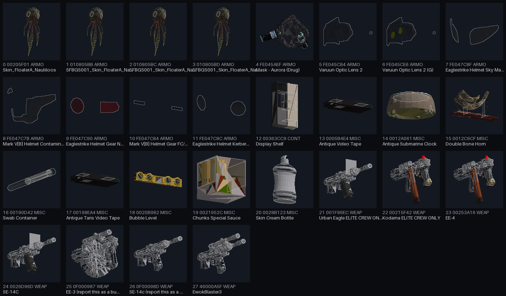
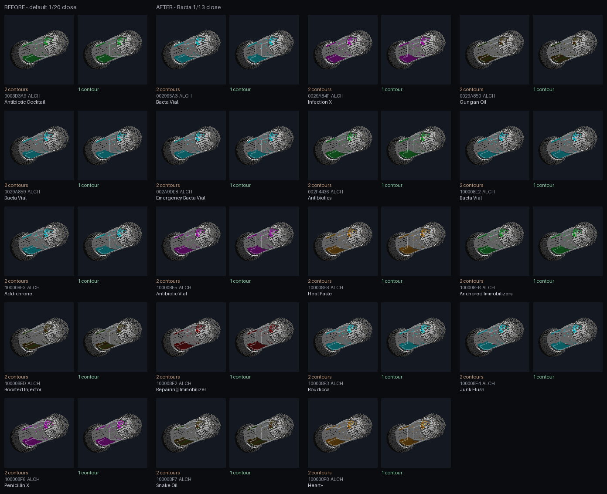
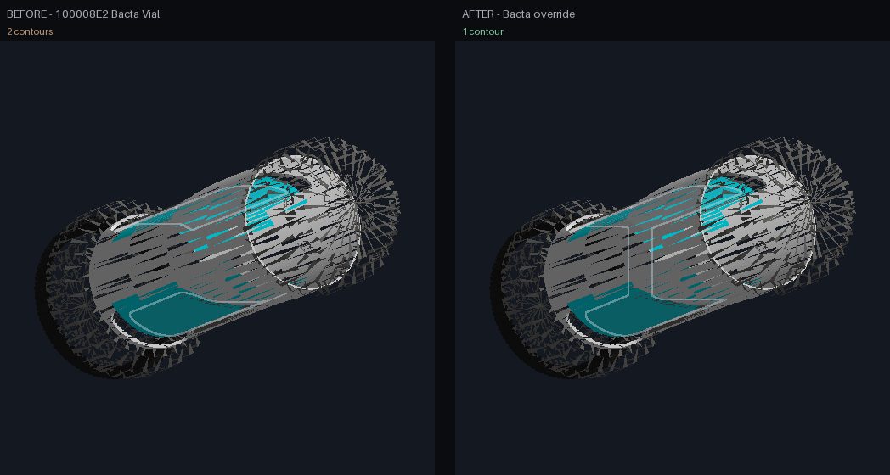

# Transparent-prop silhouette audit, 2026-11-01

Scope: every catalog record the renderer resolves geometry for - the seven item
forms (ARMO, WEAP, MISC, AMMO, ALCH, KEYM, BOOK), every container (CONT), and
any other form that carries a catalog model path - rendered at **160 px** with
the workbench's own rim rules.

| Measure | Count |
|---|---:|
| Records scanned | 11,794 |
| Items with rimmed geometry | 989 |
| Rim groups | 1,043 |
| Items with more than one rim group (separate props) | 39 |
| Items flagged before the Bacta override | 47 |
| Items flagged after it | 28 |
| ...from the seven item forms | 27 |
| ...from containers and modeled records | 1 |

The scan is reproducible with:

    python tools/renderer_recon/silhouette_audit.py --out reports/silhouette-audit-2026-11-01.tsv

It uses the same `rim_groups`, `merge_panes` and `outline_mask` as
`render_model`. Texture decode and the `.mat` colour fallback are skipped: the
rim decision comes from the material path, BSGeometry name and CDB alpha, not
from the colour map. A 30-item check against the normal path produced identical
rim decisions; only effect-only decal geometries disappear, and none of those
were rimmed.

The scan started on the seven item forms only: 10,638 records, 892 rimmed items
in 931 groups and 46 flags. Widening it added 1,156 records - containers and
modeled objects - of which 97 have rimmed geometry (display cases, shelf units,
fabricators, mulchers, blister packaging) and one flagged (the Display Shelf).
The nine non-container records outside the item forms added no rimmed geometry.
The Bacta override then cleared 19, leaving 28 flags.

The [family-grouped visual index](silhouette-index-160.png) is the whole-audit
view: the 19 cleared Bacta vials first, then the 28 remaining flags grouped by
triage family. The [interactive HTML version](silhouette-index-160.html) filters
by family, flagged/cleared state, or text (name, FormID, type, plugin or
family), highlights the matched text, shows a live match count, and links every
tile to the workbench focus view. Press `/` to focus the search box and Escape
to clear it; Clear filters resets all three controls together. The active
filters are kept in the URL (`family`, `status`, `q`) and restored on reload,
so a filtered view can be shared; Copy link copies the current filtered URL,
each tile can copy its direct workbench record URL, and Copy visible links
copies the whole filtered set one URL per line. Both are generated by
`python tools/renderer_recon/silhouette_index.py`.

## Bacta vial pane override

The 19 flagged vials shared one model family: one glass bottle split into two
panes whose frame gap is wider than the default close (about 11 px at 160). The
source mesh really is two panes, so a global radius increase was not safe - it
would also fuse eye lenses, cassette windows and spirit bubbles.

`PANE_MERGE_SCALE_BY_MODEL` now widens the close for the ten vial NIFs only:
`AfflictionCure_Antibiotics_Green_01`, `Panacaea_01`, the two
`crafted_inhailer_*` vials, and the six SWProps `Bacta*` models. Scale 13 means
12 px at 160 and 39 px at 512; it merges every size from 160 to 1024. Scale 14
merges at 160 but re-splits at 768 and 1024 because the box close is not
monotonic in radius - a thin bridge is eroded back into two islands - so scale
13 is the stable value, not a rounded-up one.

The override is keyed by NIF basename, not by the `BactaGlass` shape or
`GlassCleanTransparent01` material: injectors and sprays use the same shape and
material but are already one pane, and widening them would fuse their cap or
nozzle glass. A non-vial Bacta injector renders byte-identically after the
change.

After the override the full scan reports 28 flags: exactly the 19 vials cleared,
none added, and no other record's group or contour counts changed. Nine
representative non-vial transparent props - split visors, cassette windows,
the display case and shelf, an action-figure blister pack, and a non-vial Bacta
injector - rendered byte-identical to the before tile at 160.

The durable current-state check is
[bacta-vials-160.png](bacta-vials-160.png), produced by
`python tools/renderer_recon/bacta_vial_sheet.py`. It labels each of the 19
tiles with its closed-contour count and exits non-zero if any vial is missing,
blank or split, so it fails loudly after a pane-close regression.

## Triage

The remaining 28 flags are a handful of model families, not 28 separate faults.
Every flag is one group whose panes are further apart on screen than the
1/20-tile close radius (8 px at 160, 26 px at 512). None is a bug in the close
itself: the masks still have more than one island after closing. The contour
count treats touching rim lines as one 8-connected loop, so the island count is
reported alongside it (Bubble Level's four panes close into two islands and two
edge loops).

### Separate panes - keep separate (28 items)

| Family | Items | Contours | Why separate |
|---|---:|---:|---|
| FloaterA Nautiloos eye lenses and skins | 4 | 2 | Two eye lenses separated by the creature's head. Merging them would draw one outline around the face. |
| Varuun Optic Lens 2 / (G) | 2 | 2 | Main visor plus an independent sensor lens. |
| SpartanArmorCollection split visors (Eaglestrike Sky Marshal/Kerberos/Nocturne, Reach Contaminator, FC/ALFA) | 5 | 2 | Left and right panes with a frame between them; they are not adjacent panes of one shell. |
| SW weapon lens stacks (Urban Eagle, Kodama, EE-4, SE-14C, EE-3, SE-14c, EwokBlaster) | 7 | 2-3 | Separate lens elements; EE-3 and EwokBlaster also have a second rim group for their scope. |
| Antique Video Tape / Antique Taris Video Tape | 2 | 2 | Two cassette windows on one tape. |
| Bubble Level | 1 | 2 | Four separate spirit bubbles; connectivity of the rim lines reduces them to two edge loops. |
| Aurora mask | 1 | 2 | Visor plus a separate glass insert. |
| Antique Submarine Clock | 1 | 2 | Glass dome plus a separate window. |
| Double Bone Horn | 1 | 2 | Two independent clear-plastic pieces. |
| Swab Container | 1 | 2 | Tube wall and bottom are separate source panes; the screen gap is wider than the close radius. |
| Chunks Special Sauce | 1 | 2 | Front and back glass panels of the cube. |
| Skin Cream Bottle | 1 | 2 | Separate shell halves of the bottle. |
| Display Shelf | 1 | 2 | One shelf shape contains three frosted panes; the front and side panes project as two panels. Merging them would hull the open corner instead of following the glass. |

For the bottle and tube, merging would make a prettier single outline, but the
source mesh really contains separate panes and the screen gap is 2-4x the
close radius. A global radius increase would also fuse the eye lenses,
cassette windows, spirit bubbles and scope elements above, so it is not a safe
rule. The Bacta family was the one case where the two panes are halves of one
shell; it now uses the model-keyed override above, and those 19 items no longer
flag.

The table's 28 items remain separate for the same geometric reason: their
islands need a radius of 10-21 at 160 (the cassette windows need more than 40),
or more than 40 at 512, and several are semantically distinct windows, lenses or
bubbles. They are not candidates for a shape- or material-wide override.

The widened scope also added 15 containers with more than one rim group, and
none of them is flagged: a fabricator's or mulcher's panes are separate
world-space boxes and keep one contour each, as do the clear blister packs of
sealed action figures and the lidded trays for Sweet Rolls, Corellian Melt and
Nerf Ham Toastwrap. Those groups are not a silhouette failure; joining them
would outline the opaque frame between two different glass parts.

## Result

One renderer change was made from this audit: the model-keyed Bacta close. The
remaining 28 flags are expected multi-pane props under the "merge nearby panes,
keep separate props apart" rule; the full data is in
[silhouette-audit-2026-11-01.tsv](silhouette-audit-2026-11-01.tsv).

The audit tool and its tests are new. Its only supporting change is an opt-in
loose-file index on `AssetStore`, which takes the full scan from about
838 ms/item to about 80 ms/item after a one-time 15 s index over 549 MO2 mod
folders. The renderer change is the Bacta override described above.

## Appendix: remaining flagged records

- **FloaterA eye lenses (4)**: 00205F01 Skin_FloaterA_Nautiloos, 010805BB,
  010805BC, 010805BD (the three ShatteredSpace skins).
- **Varuun visor + sensor (2)**: FE045C84, FE045CE6 Varuun Optic Lens 2 / (G).
- **Spartan split visors (5)**: FE047C8F Eaglestrike Sky Marshal, FE047C7B Mark
  V[B] Contaminator, FE047C90 Eaglestrike Nocturne Goggles, FE047C84 Mark V[B]
  FC/ALFA, FE047C8C Eaglestrike Kerberos.
- **SW weapon lens stacks (7)**: 001F96EC Urban Eagle, 00215F42 Kodama,
  00253A16 EE-4, 0026D96D SE-14C, 0F000987 EE-3, 0F00098D SE-14c, 46000A5F
  EwokBlaster3.
- **Tape windows (2)**: 0005B4E4 Antique Video Tape, 00198EA4 Antique Taris
  Video Tape.
- **Bubble Level (1)**: 0020B982.
- **Separate glass inserts (5)**: FE045AEF Aurora mask, 0012A061 Submarine
  Clock, 0012C6CF Double Bone Horn, 00190D42 Swab Container, 0021952C Chunks
  Special Sauce.
- **Display Shelf (1)**: 00363CC9 CONT, three frosted panes in
  `MeshShelfMedMod05:3`.
- **Shell halves (1)**: 0028B123 Skin Cream Bottle.

## Cleared by the Bacta override (19)

- **Panacaea vials (3)**: 002995A3, 0029A859, 002A9DE8 Bacta Vial.
- **Antibiotics (2)**: 0003D3A9 Antibiotic Cocktail, 002F4436 Antibiotics.
- **Crafted inhalers (2)**: 0029A84F Infection X, 0029A850 Gungan Oil.
- **SWProps Bacta variants (12)**: 100008E2 / E3 / F3 / F4 (Bacta.nif),
  E5 / F6 (Bacta_Pink), E8 / F8 (Bacta_Orange), EB (Bacta_green), ED / F7
  (Bacta_Yellow), F2 (Bacta_Red).

